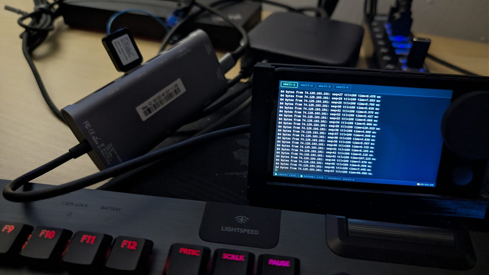

  

  
   
  <em>A Car Thing in a USB-C dock running the on-device terminal, with Wi-Fi up and a ping succeeding.</em>

thing-revived revives the discontinued Spotify Car Thing (community codename superbird) as a standalone on-device terminal and settings surface. A custom Yocto image boots straight into a Chromium 147 kiosk (verified on the device on 2026-11-22) on the device's own screen. The knob, buttons and touchscreen drive a terminal UI and a settings menu, and a paired Bluetooth keyboard types into the terminal.

## What works today

- Terminal: several live PTY sessions rendered with vendored xterm.js, typed from a Bluetooth keyboard, with the device buttons and knob handling session chrome (switch, interrupt, clear, respawn). See [docs/terminal.md](docs/terminal.md).
- Settings menu: Bluetooth, brightness, timezone and Wi-Fi.
- Wi-Fi: verified on real hardware with a D-Link DWA-171 (rtw88_8821cu) through a USB-C dock in USB host mode. Ethernet through the dock also works. See [docs/wifi.md](docs/wifi.md).
- Both services run under systemd on the device and listen on loopback only. Full status and verification history: [docs/development.md](docs/development.md).

Not a goal: smart-home or Bluetooth-peripheral control. The terminal and settings menu are the deliverable.

## Quick start

Build and flash the image with `build/build-image.sh` and `build/flash-image.sh`. The steps, prerequisites and device-access facts are in [docs/yocto-build-and-flash.md](docs/yocto-build-and-flash.md) and [build/README.md](build/README.md). Configuration lives in `config/*.toml`, installed on the device under `/etc/thing-revived/` (see [config/README.md](config/README.md)). Start with [docs/overview.md](docs/overview.md) for a map of the rest of the documentation.

## Repository layout

| Path | Contents |
|---|---|
| `controller/` | Rust `controller-agent`: reads the buttons and knob, serves the settings backend (Bluetooth, brightness, timezone, Wi-Fi) over a WebSocket bridge on 127.0.0.1. |
| `daemon/` | Rust `terminal-agent`: PTY sessions served over a WebSocket. |
| `frontend/` | Kiosk web app: classic scripts with no build step, a statechart interaction layer, screens defined as data, vendored xterm.js. |
| `config/` | `controller.toml`, `terminal.toml`, `frontend.toml`, and `config/protocol/` with the golden wire fixtures shared by the tests. |
| `build/` | `build-image.sh`, `flash-image.sh`, Yocto overlay recipes and helper tools. `build/artifact/` is gitignored. |
| `deploy/` | Legacy supervisord config, kept for reference only. |
| `docs/` | Project documentation and the research trail. |

## Documentation

- [Overview](docs/overview.md)
- [Current state](docs/development.md)
- [Architecture](docs/architecture.md)
- [Hardware](docs/hardware.md)
- [Terminal](docs/terminal.md)
- [Wi-Fi](docs/wifi.md)
- [Build and flash](docs/yocto-build-and-flash.md)
- [Dependency surface](docs/dependency-surface.md)
- [Coming soon](docs/coming-soon.md)
- [Research](docs/research/)

## License

MIT, see [LICENSE](LICENSE).
