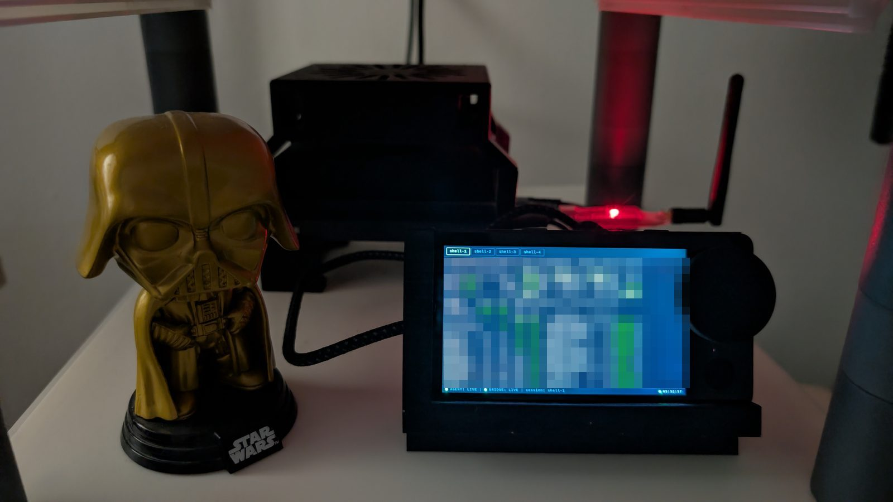
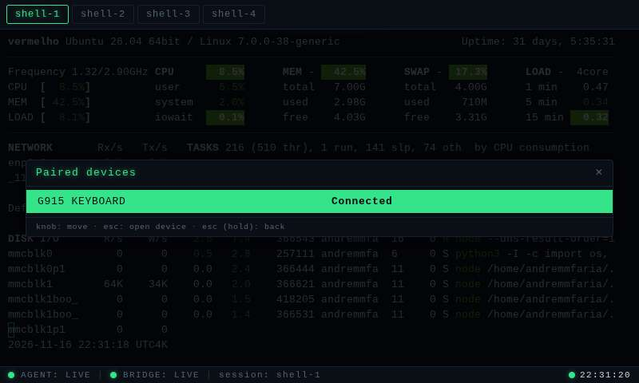
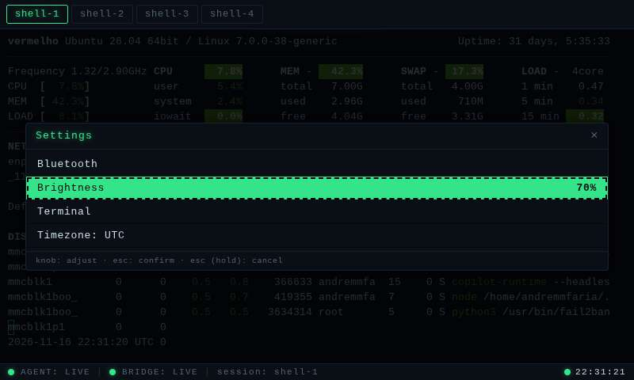

# On-Device Terminal

A terminal emulator rendered by the Chromium 147 kiosk (verified on the device on 2026-11-22), backed by real PTYs on the device and typed into from a Bluetooth-paired keyboard. Motivated by the feasibility research in [`research/bt-hid-terminal-feasibility.md`](research/bt-hid-terminal-feasibility.md). Real-hardware verification history: [`research/terminal-hardware-verification.md`](research/terminal-hardware-verification.md).

## What it does

The kiosk shows one terminal screen with a tab per session. By default there are four tabs, `shell-1` to `shell-4`, each a plain login `bash`. Keystrokes come from a paired Bluetooth keyboard (BlueZ HID host role). The four numbered hardware buttons switch directly to sessions 1 to 4, and the knob scrolls the scrollback when the settings menu is closed. A status bar shows the connection state of the terminal agent and the controller bridge, the active session and a clock.


Because xterm.js interprets the full ANSI/VT100 and curses escape set, full-screen programs work in a tab, not only line-oriented shells.



## Architecture

```
BT keyboard --(evdev, native Chromium input)--> frontend/ (xterm.js)
                                                      |  ws://127.0.0.1:8766
                                                      v
                                       daemon/ (Rust: terminal-agent)
                                                      |  one PTY per [[session]]
                                                      v
                                       bash -l (default) or any configured command

buttons --(evdev, grabbed)--> controller/ (Rust: controller-agent)
                                                      |  ws://127.0.0.1:8765
                                                      v
                                       frontend/ (session switch, knob scroll, menu)
```

- **`daemon/`** is the `terminal-agent` binary. It spawns one PTY per `[[session]]` table in `terminal.toml`, relays I/O to clients over a WebSocket on `127.0.0.1:8766`, respawns sessions that exit unexpectedly, and runs the clock sync thread. Sessions are data: each one is a program plus arguments, so a tab can run any command, not only a shell.
- **`controller/`** is the `controller-agent` binary. It grabs the hardware buttons, serves button and knob events to the frontend on `127.0.0.1:8765`, and handles the settings menu's Bluetooth, Wi-Fi, timezone and brightness commands. Its layering and ports are described in [`architecture.md`](architecture.md).
- **`frontend/`** is a classic-script kiosk web app with no build step and no framework. It opens one reconnecting WebSocket to each agent. Interaction is a statechart (`src/interaction/`), menu screens are data (`src/menu/screens/`), and the terminal pieces live in `src/terminal/` (tabs, sessions with a per-tab replay buffer, xterm view). Tunables come from `config/frontend.toml`, converted at image build time to `config.generated.js` because the kiosk cannot read TOML.

Keyboard text needs no `controller/` involvement. Once a paired keyboard shows up as a normal `/dev/input/eventN` node, Chromium turns keystrokes into ordinary DOM `keydown` events, and `frontend/src/input/keyboard.js` maps them to PTY bytes (printable keys, Ctrl+A to Ctrl+Z, Enter, Backspace, Tab, Escape and the arrow keys). While the settings menu is open, keystrokes are swallowed so nothing types into a session underneath it.

## Frontend rendering

- xterm.js 5.3.0 and FitAddon 0.8.0 are vendored as UMD builds under `frontend/vendor/` (provenance in `frontend/vendor/README.md`). The frontend still follows a conservative baseline from the days when the browser was believed to be Chromium 68 or 69: every script is a classic script and the code avoids newer syntax. The Chromium 147 browser no longer requires that baseline. Classic scripts are kept partly because ES modules are expected to be blocked on a `file://` page (not yet tested on the device) and because the same files load under node for tests. See the [Chromium 147 frontend audit](research/chromium-147-frontend-audit.md).
- One shared `Terminal` instance renders the active tab. Each session keeps a replay buffer (`replay_buffer_bytes`, 256 KiB by default) used to repaint the terminal when you switch tabs.
- FitAddon computes `cols` and `rows` from the container's pixel size and the font metrics, and the frontend sends a `resize` on connect, resize and tab switch.
- Font size and font family are adjustable live from the settings menu's Terminal screen. Defaults and ranges, scrollback length, knob scroll step and colors are in `config/frontend.toml`.

## Configuration

`config/terminal.toml` (installed as `/etc/thing-revived/terminal.toml`) holds the session list, bind address, logging, PTY sizing, the respawn policy and the clock status settings (`[clock]`: `enabled`, `interval_secs`, `backoff_secs`). Every key is optional and the file documents the compiled-in defaults. Giving any `[[session]]` table replaces the default four shells. An invalid file stops the agent with exit code 78.

The agent respawns a session that exits unexpectedly up to `[respawn] max` times within `window_secs`, with delays from `delays_secs` (0, 2 and 5 seconds by default). After that the tab reports `needs_manual_respawn` and waits for a manual respawn.

## Wire protocol (frontend <-> agent, port 8766)

One JSON object per WebSocket text frame, tagged by `type`.

```
agent -> frontend:
  {"type": "session_list", "sessions": [{"index": 0, "name": "shell-1"}, ...]}
  {"type": "output", "session": 0, "data": "<decoded pty stdout chunk>"}
  {"type": "exited", "session": 0, "code": 0,
   "auto_respawning": false, "needs_manual_respawn": false}
  {"type": "clock_sync", "offset_ms": 0, "status": "ok" | "stale" | "unsynced",
   "age_s": 12}

frontend -> agent:
  {"type": "input", "session": 0, "data": "<raw keystrokes>"}
  {"type": "resize", "session": 0, "cols": 118, "rows": 33}
  {"type": "control", "session": 0, "action": "interrupt" | "clear" | "respawn"}
```

`clock_sync` reports whether the system clock is NTP synchronized, not an offset from a host. The image runs systemd-timesyncd, and the agent polls `timedatectl show -p NTPSynchronized` every `interval_secs` while synchronized, backing off per `backoff_secs` otherwise. `status` is `ok` when synchronized, `unsynced` if it never has been (or the status command failed before the first success), and `stale` if it was synchronized earlier and no longer is. `offset_ms` is kept for wire compatibility and is always 0. `age_s` is present only when `status` is not `ok`. Unknown or malformed client frames are ignored, and there is no error message type. Canonical examples of every message are the golden fixtures in [`config/protocol/terminal/`](../config/protocol/terminal/), asserted byte for byte by the daemon's tests. Knob scrolling is not part of this protocol: xterm.js owns the scrollback, and the knob events arrive from the controller bridge.

## Screenshots

Settings menu and Bluetooth pairing flow on the physical device:

    

## Known limitations

- **No TLS and no auth** on the terminal WebSocket. It listens on loopback only by default (`127.0.0.1:8766`, override with `TERMINAL_AGENT_BIND` or `[server] bind`) and the kiosk frontend is its only client. Sessions run as the `kiosk` user, not root, so root work needs `sudo` and the `kiosk` password (see [`users.md`](users.md)). Do not widen the bind: this port is an unauthenticated shell as `kiosk`, which has `sudo` and the `adm` group. For remote development, run `ssh -L 8766:127.0.0.1:8766 kiosk@<device>` on your development host, reaching the device over the dock Ethernet network or the USB device-role link. The USB gadget link is down at boot in the default image, see [`hardware.md`](hardware.md). See the Security model in [`architecture.md`](architecture.md#security-model).
- **No hang detection.** Automatic respawn covers sessions that exit. Nothing detects a PTY that is alive but unresponsive, so that case needs a manual `respawn` control.
- **`clear` is a Ctrl-L keystroke**, so it only clears programs that bind Ctrl-L to a screen clear (most shells do via readline). It is not a terminal reset sequence.
