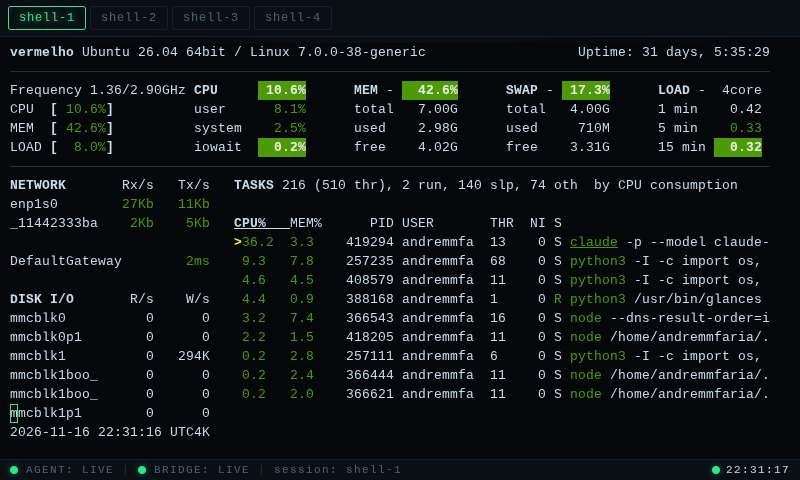
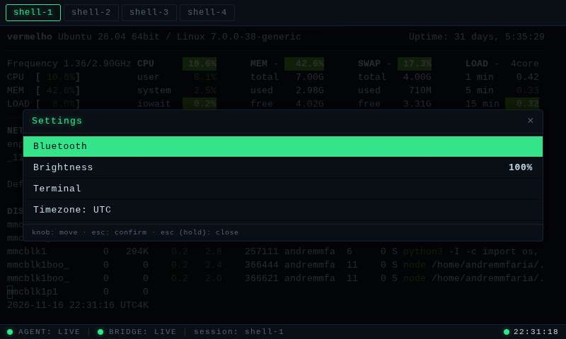
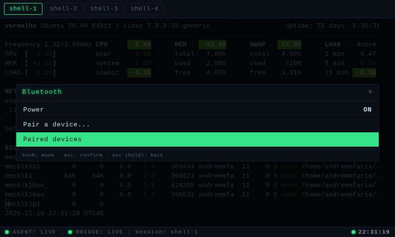
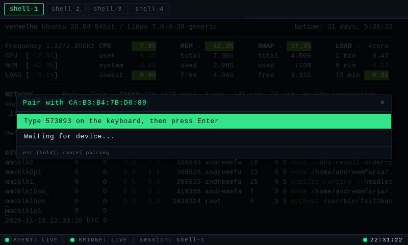

# On-Device Terminal

A terminal emulator rendered by the Chromium kiosk, backed by a real PTY on the device, reachable from a Bluetooth-paired keyboard. Motivated by the feasibility research in [`research/bt-hid-terminal-feasibility.md`](research/bt-hid-terminal-feasibility.md). Full real-hardware verification history: [`research/terminal-hardware-verification.md`](research/terminal-hardware-verification.md).

## What it shows / does

A single-screen terminal with session tabs, backed by one or more PTY processes (a local shell, or `ssh <host>`), typed into with a Bluetooth keyboard via BlueZ's HID-host role, and navigated with the device's existing physical buttons (direct session switch) and knob (scrollback).



## Architecture

Two pieces, plus `controller/`:

- **`frontend/`**: a static `index.html` + `style.css` + `app.js` page, no build step, no framework. It opens two local WebSockets:
  - `ws://localhost:8766` to `daemon/` (Rust binary `terminal-agent`) for PTY input/output/resize/control.
  - `ws://localhost:8765` to `controller/`, read-only, to receive the raw `{"type":"button",...}` / `{"type":"knob",...}` messages for session-chrome.
- **`daemon/`** (Rust binary `terminal-agent`): on-device, spawns one PTY per entry in `terminal-agent-config.json` and relays I/O to the frontend over its own WebSocket. Config (shell vs `ssh user@host`) is data, not hardcoded, so it works identically whether or not an SSH client is present.

```
BT keyboard --(evdev, native Chromium input)--> xterm.js (frontend)
                                                        |  ws://localhost:8766
                                                        v
                                         daemon/ (Rust: terminal-agent)
                                                        |  libc::openpty() + std::process::Command
                                                        v
                                        local shell  /  ssh user@host (config-selected)

buttons + knob --(evdev, grabbed)--> controller/ (EVIOCGRAB + uinput, see research/button-knob-clock-design.md)
                                                        |  ws://localhost:8765
                                                        v
                                   frontend's session-chrome handler
```

Why keyboard text input needs no `controller/` or evdev changes at all: once a paired BT keyboard surfaces as a normal `/dev/input/eventN` node (BlueZ `input` plugin + kernel `uhid`), Chromium's own native input stack turns keystrokes into ordinary `keydown`/`keyup` DOM events automatically — exactly how the touchscreen already bypasses the bridge daemon (`research/hardware-interaction.md` point 2). `frontend/app.js` just has a standard browser `keydown` handler.

The buttons/knob extension point — direct per-button session switching via an `EVIOCGRAB`+`uinput` mechanism in `controller/` — is implemented and live; see [`research/button-knob-clock-design.md`](research/button-knob-clock-design.md) for the real mechanism and the confirmed `BUTTON_SESSION_MAP`.

## Language choices

- **`daemon/`: Rust, matching `controller/`'s own toolchain and build convention.**
  - **WebSocket server:** `tungstenite`, the same crate `controller/src/main.rs` depends on — the sync variant (`tungstenite::accept` + one OS thread per client), not an async `tokio-tungstenite` runtime, matching `controller/`'s own sync/threaded style.
  - **PTY handling:** `libc::openpty` (a glibc/BSD extension) plus `std::process::Command` with `CommandExt::pre_exec` for `setsid()` followed by `ioctl(slave_fd, TIOCSCTTY)`, giving the child a real controlling terminal so `SIGWINCH` delivery on resize works correctly.
  - Reading and writing the same sync `WebSocket` concurrently from separate threads (needed so PTY output broadcasts never block on, or get blocked by, a slow/idle client read) is done by `try_clone()`-ing the underlying `TcpStream` into a second, write-only `WebSocket` instance rather than wrapping one `WebSocket` in a `Mutex` with a short read timeout.
- **`frontend/`: static HTML/CSS/JS, non-module `<script>` tags, ES6-only syntax** — `app.js` follows a plain, dependency-free style matching the rest of this repo's frontend code.
- **`frontend/`: real, vendored xterm.js 5.3.0 + FitAddon 0.8.0, not a placeholder.** `frontend/vendor/` ships the UMD `xterm.js` build, `xterm.css`, and `xterm-addon-fit.js` (see `frontend/vendor/README.md` for exact provenance). `app.js` creates one shared `Terminal` instance, writes every WebSocket `output` chunk straight to it via `term.write()`, and uses `FitAddon` to compute real `cols`/`rows` from the container's actual pixel size and the terminal's font metrics. This gives full ANSI/VT100 and curses interpretation (cursor movement, color, alternate-screen apps), not a raw line-buffer dump.

## Wire protocol (frontend <-> agent, port 8766)

```
agent -> frontend:
  {"type": "session_list", "sessions": [{"index": 0, "name": "local-shell"}, ...]}
  {"type": "output", "session": 0, "data": "<decoded pty stdout chunk>"}
  {"type": "exited", "session": 0, "code": 0,
   "auto_respawning": false, "needs_manual_respawn": false}
  {"type": "clock_sync", "offset_ms": 42, "status": "ok" | "stale" | "unsynced",
   "age_s": 12}

frontend -> agent:
  {"type": "input", "session": 0, "data": "<raw keystrokes>"}
  {"type": "resize", "session": 0, "cols": 118, "rows": 33}
  {"type": "control", "session": 0, "action": "interrupt" | "clear" | "respawn"}
```

`resize`'s `cols`/`rows` are computed live by `FitAddon` from `#screen`'s actual pixel size and the terminal's own font metrics on every connect/resize/tab-switch.

`exited`'s `auto_respawning`/`needs_manual_respawn` fields and the standalone `clock_sync` message type are documented in full (including the retry/backoff and host-discovery logic behind them) in [`research/button-knob-clock-design.md`](research/button-knob-clock-design.md), and implemented in `daemon/src/main.rs`'s own doc comment at the top of that file.

Knob-scroll is NOT in this protocol at all: xterm.js owns scrollback internally (`term.scrollLines()`), so scrolling is a pure client-side operation against `controller/`'s existing `knob` messages, no agent round-trip needed.

## Screenshots

Real screenshots of the settings menu and Bluetooth pairing flow on the physical device:

    

## Known limitations

- **No `wss://`/TLS, no auth** on the `tungstenite` WebSocket server: acceptable because `terminal-agent` listens on loopback only by default (`127.0.0.1:8766`, override with `TERMINAL_AGENT_BIND`) and the kiosk frontend is its only client, the same trust model `controller/` uses for its own WebSocket. Do not widen the bind: this port is an unauthenticated root shell. For remote development use `ssh -L 8766:127.0.0.1:8766 root@<device>`. See the Security model in [`architecture.md`](architecture.md#security-model).
- **No automatic wedge detection.** "Respawn if wedged" is a manual button-triggered action (`control`/`respawn`), not an automatic liveness check; nothing currently detects a hung PTY on its own.
- **`Ctrl-L`-as-clear** only works for programs that bind it to a screen clear (most shells do via readline); it is not a true terminal reset escape sequence.
- Only tested with one frontend client connected at a time; the agent broadcasts to all connected clients, but multi-client behavior (e.g. two browser tabs typing into the same session) is untested.
