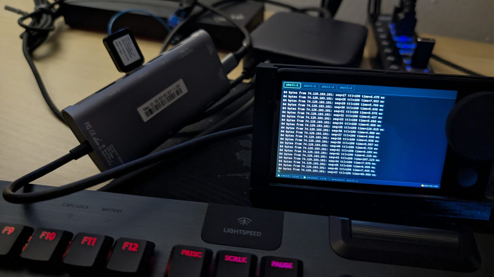
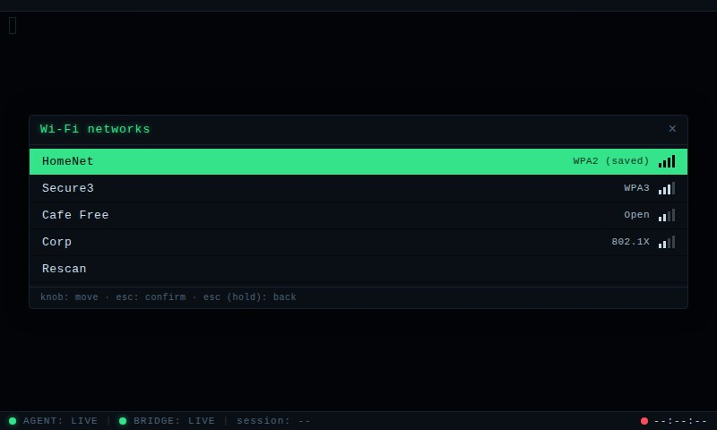
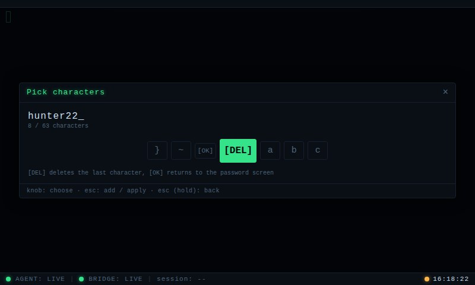

# Wi-Fi

Wi-Fi settings in the on-device menu: status, scan, connect (with password entry), saved networks with forget, and auto-reconnect at boot.

The device has no on-board radio. Wi-Fi comes from a USB adapter in host mode (D-Link DWA-171 rev A1, B1 or C1, plus the other drivers listed in [`../build/README.md`](../build/README.md)) plugged into a dock or OTG adapter. The Wi-Fi item appears in Settings only while a wireless interface exists.

## Status

Verified on real hardware by the owner on 2026-11-22: a D-Link DWA-171 (rev C1, driver `rtw88_8821cu`) behind a USB-C dock in host mode scanned, connected and pinged a public IP address from the on-device terminal. Ethernet through the same dock also works. Only that adapter has been tested. The other drivers in the image, WPA3, open networks, 5 GHz and the other edge cases are covered by unit and fake-socket tests only, see [Tests](#tests) and [Not verified](#not-verified).

*The verification setup: device in its stand, USB-C dock with the Wi-Fi adapter, and a ping to a public IP address in the on-device terminal.*

The two screenshots below are from headless Chromium with a mocked WebSocket, not from the device.

## Design

### Backend: wpa_supplicant control socket, not D-Bus

The controller speaks wpa_supplicant's unix datagram control protocol (the one `wpa_cli` uses) with `std::os::unix::net::UnixDatagram`. The socket client is `controller/src/adapters/wpa_ctrl.rs`, the flows are in `controller/src/services/wifi.rs`, and the pure parsing and validation is in `controller/src/domain/wifi/` (`scan`, `status`, `validate`, `events`, `tracker`). The socket is `/run/wpa_supplicant/<ifname>`.

Why not D-Bus with `zbus`, which `bluetooth.rs` uses:

- Persistence is one documented command (`SAVE_CONFIG`) against the config file, with no D-Bus equivalent to rely on.
- The text protocol is easy to test with fixtures and a fake socket. The D-Bus dict-of-variants shapes for network and BSS properties are not.
- No new crate and no dependency on wpa_supplicant's D-Bus policy file or bus activation. The image's wpa_supplicant 2.11 does ship the D-Bus interface, so this is a preference, not a necessity.

The cost is hand-parsing text replies, done in pure, unit-tested functions. One real limitation: wpa_supplicant truncates the `SCAN_RESULTS` reply at 4096 bytes (`reply_size` in `ctrl_iface.c`), roughly 50 access points. A truncated last line is discarded, but in a very crowded area the strongest network could be among the ones cut off. The same text path prints SSIDs with non-ASCII bytes as `_`, so such SSIDs cannot be connected to.

### Networking: systemd-networkd, same as Ethernet

The image uses `systemd-networkd` with `80-wired.network` (`Type=ether`, DHCP, route metric 10) and `systemd-resolved`, and no interface renaming, so the adapter is `wlan0`. The overlay adds `80-thing-revived-wifi.network` (`Type=wlan`, DHCP, route metric 20) so Ethernet keeps the default route when both are up. Wi-Fi gets DHCP the same way Ethernet does, with no extra client.

### Starting wpa_supplicant

Upstream's `wpa_supplicant.service` (D-Bus activated) ships disabled and is left alone. The overlay installs the template `thing-revived-wpa@.service`:

- `wpa_supplicant -c /var/lib/thing-revived/wpa_supplicant.conf -i %I -D nl80211`, `UMask=0077`.
- `BindsTo=` and `After=sys-subsystem-net-devices-%i.device`, so it waits for the interface and stops when the adapter is unplugged. A re-plug starts a fresh instance.
- `After=systemd-tmpfiles-setup.service` so the config exists first.

Two things start it, and either alone is enough:

1. **udev rule** `90-thing-revived-wifi-wpa.rules`: on `add` of a net device with `DEVTYPE=wlan`, tag it for systemd and set `SYSTEMD_WANTS=thing-revived-wpa@$name.service`. This is the standard hotplug pattern and also covers boot-time coldplug.
2. **controller-agent fallback**: its watcher notices a wireless interface with no control socket and runs `systemctl start --no-block thing-revived-wpa@<if>.service`, at most once per `service_start_retry_secs` (default 10).

Together they cost at most one redundant, idempotent `systemctl start`, and the fallback covers a udev miss. A template unit cannot be `enable`d without an instance name, so there is no enabled symlink; the udev rule is the enable mechanism.

C1 adapters first appear as the Realtek storage device `0bda:1a2b`. The existing `80-thing-revived-wifi-modeswitch.rules` ejects it, it re-enumerates as `2001:331d`, `rtw88_8821cu` binds and creates the netdev, and only then the rule above fires. Nothing needs to wait for the modeswitch explicitly, because no wireless interface exists before it.

### Files and paths

| Path | What | Mode |
|---|---|---|
| `/var/lib/thing-revived/` | state directory on the data partition (created by tmpfiles.d at boot) | 0700 root |
| `/var/lib/thing-revived/wpa_supplicant.conf` | wpa_supplicant config and saved networks (passphrases in clear text, as wpa_supplicant stores them) | 0600 root |
| `/run/wpa_supplicant/<ifname>` | control socket (tmpfs) | root |
| `/tmp/thing-revived-wpa-<pid>-<n>` | the agent's short-lived client sockets | root |

The initial config is `ctrl_interface=/run/wpa_supplicant` and `update_config=1`. It is created by `tmpfiles.d` (`f`, only if missing) and, as a fallback, by `ensure_config` at agent start. Existing files are never overwritten, so saved networks survive. `/etc` is on the read-only rootfs, which is why the config lives under `/var`. The 0700 directory also covers `settings.json` and the other files there, which the root-owned agents are unaffected by. The paths are configurable in the `[wifi]` section of [`config/controller.toml`](../config/controller.toml) (`ctrl_dir`, `state_dir`, `conf_path`, `net_class_dir`).

No country code is set, so the kernel uses the world regulatory domain (conservative on 5 GHz channels). `wireless-regdb-static` is installed, so setting a `country=` line in the config is the follow-up if 5 GHz networks are missing.

### Hotplug detection

The agent's watcher thread polls `/sys/class/net/*/wireless` and `/sys/class/net/*/phy80211` every `poll_interval_secs` (default 3), with polling rather than netlink since no netlink crate is a dependency. On a change it broadcasts `wifi_available`. While an interface exists it also reads status on the same interval and broadcasts `wifi_status` only when something changed. A client that connects later sends `wifi_get` and is told the current state. The menu shows or hides the Wi-Fi row live, and if the adapter disappears while a Wi-Fi screen is open the menu returns to the top level.

### Connecting

`wifi_connect` runs on its own thread (it blocks for seconds):

1. The security type is looked up from the agent's own last scan, never trusted from the client. Not in the last scan: open if the password is empty, else WPA2-PSK.
2. SSID and password are validated (below). Then `ADD_NETWORK`, `SET_NETWORK` for `ssid` (hex), `key_mgmt` (`NONE`, `WPA-PSK`, `SAE` with `ieee80211w 2`, or `WPA-PSK SAE` with `ieee80211w 1` for transition mode) and `psk`, then `SELECT_NETWORK`.
3. It waits up to `connect_timeout_secs` (default 40) on an attached event socket for `CTRL-EVENT-CONNECTED`, mapping failures: `SSID-TEMP-DISABLED reason=WRONG_KEY` or a 4-way handshake failure is `wrong_password`; two `NETWORK-NOT-FOUND` is `network_not_found`; three `ASSOC-REJECT` is `assoc_rejected`; nothing in time is `no_response`.
4. After association it polls `STATUS` for an `ip_address` for up to `dhcp_timeout_secs` (default 25, networkd's DHCP), else `dhcp_timeout`.
5. On success: remove older saved entries with the same SSID, `ENABLE_NETWORK all`, then `SAVE_CONFIG`. The `ENABLE_NETWORK all` matters: `SELECT_NETWORK` marks every other saved network disabled, and that flag is written to the file, which would stop them auto-connecting at the next boot. On failure: remove the new entry, `ENABLE_NETWORK all`, nothing is saved, and a previously saved entry for that SSID is untouched.

Selecting an already-saved network from the scan list uses `wifi_connect_saved` (no password prompt). To change a saved network's password, forget it first.

Auto-reconnect at boot is wpa_supplicant's own behavior with the saved, enabled networks in the config; the agent does nothing special.

## Security

- The password travels once: frontend to `wifi_connect` over the local WebSocket, then one `SET_NETWORK <id> psk "..."` datagram, then wpa_supplicant's 0600 config in a 0700 directory. The agent never writes it anywhere itself.
- Never logged: the inbound message type wraps the password in a `Secret` whose `Debug` prints `<redacted>`, the ctrl client never puts a command into an error string, the agent does not log inbound messages, and no outbound event carries a password (a test asserts this for the connect result events).
- No credentials are stored in the repo or shipped in the image.
- Validation before anything is sent: SSID 1 to 32 bytes with no control characters; WPA2/WPA3 passphrase 8 to 63 printable ASCII characters (the ASCII limit also keeps newlines out of the line-based ctrl command); open networks must send no password; WEP and 802.1X networks are listed but refused. The frontend repeats the password check for fast feedback, the agent stays the authority.
- Escaping: the SSID is sent hex-encoded, so quoting does not apply. The passphrase is sent inside double quotes; wpa_supplicant takes the text between the first and last quote with no backslash processing, so embedded `"` and `\` are safe once newlines and control characters are excluded.
- The UI masks the password (a "Show password" toggle reveals it) and the real `<input>` is `type=password` unless shown. The password is cleared from frontend state when its screen is left or on success.
- Network exposure: the bridge WebSocket listens on loopback only by default (`127.0.0.1:8765`, override with `CONTROLLER_BIND`), so only the on-device kiosk frontend can send these commands (connect, forget, and the existing BT and brightness ones). Widening the bind makes them reachable by any host on the network and is an explicit opt-in. For remote development, forward the port over SSH. See the Security model in [`architecture.md`](architecture.md#security-model).

## Menu and input

Entry: Settings, Wi-Fi (row text shows the SSID when connected). Screens: Wi-Fi home (status block: state, network, IP, signal bars and percent, interface, whether Ethernet is also up; then Scan for networks, Saved networks, Disconnect), network list (strongest first, signal bars, security label, "(saved)"), password, knob picker, connecting/result, saved networks, per-network actions (Connect, Forget...), forget confirmation.

Input follows the existing menu semantics: knob moves the highlight, knob push or ESC tap selects, ESC hold or button 1 goes back, buttons 2 to 4 are ignored.

Password screen rows: `Password` (select to edit), `Show password`, `Pick characters with knob...`, `Connect`.

- **Text field.** Selecting the Password row focuses a real `<input>`. The Chromium on-screen keyboard appears for touch, and a Bluetooth keyboard types into it. Enter (keyboard, on-screen keyboard Go key, knob push) or ESC tap ends editing, ESC hold or button 1 also ends it. Knob rotation does nothing while editing. A knob push reaches the page twice (the bridge `button` message and the uinput-replayed Enter keystroke), so a guard (`enter_guard_ms` in [`config/frontend.toml`](../config/frontend.toml), default 400 ms) swallows the second one instead of re-opening the field.
- **Knob picker.** A ring of control tokens then printable ASCII: `[OK]`, `[DEL]`, `a` to `z`, `A` to `Z`, `0` to `9`, space and symbols. It starts on `a`, wraps in both directions, and `[OK]` and `[DEL]` sit just left of `a`, so one or two detents backwards from the start reaches them. Knob rotates (one step per detent), push or ESC tap applies the item under the cursor: append a character, delete the last one with `[DEL]`, or return to the password screen with `[OK]` (which lands on Connect). ESC hold or button 1 returns without discarding what was typed. Tapping a neighbouring cell moves there, tapping the centre applies it. Maximum 63 characters.
- **Result screen.** Failure shows the message and a Back row (the typed password is kept so it can be corrected). Success shows Done, which returns to Wi-Fi home and clears the password. Backing out while an attempt is in flight is allowed; the result then arrives as a toast.

The screens are data in `frontend/src/menu/screens/wifi.js`, driven by the interaction statechart. Pure UI logic (validation, picker ring, signal bars, status rows) is in `frontend/src/wifi/wifi-logic.js`, a classic script unit-tested under node. While the first scan has no results the list shows a single `Scanning...` label; the Rescan row appears once results (or a failure) arrive and reads `Scanning...` during later rescans.

## Wire protocol

Same socket and conventions as the rest of the bridge (`ws://localhost:8765`, JSON with a `type` tag). Golden fixtures for most of these messages are in `config/protocol/controller/`.

Client to agent:

| type | fields | notes |
|---|---|---|
| `wifi_get` | | reply: `wifi_available` then `wifi_status` |
| `wifi_scan` | | async: `wifi_scan_started`, then `wifi_scan_results` |
| `wifi_connect` | `ssid`, `password` (optional, empty for open) | async: `wifi_connecting`, then `wifi_connect_result` |
| `wifi_connect_saved` | `ssid` | same events as above, no password |
| `wifi_disconnect` | | followed by `wifi_status` |
| `wifi_saved_list_get` | | reply: `wifi_saved_list` |
| `wifi_forget` | `ssid` | reply: `wifi_saved_list`, then `wifi_status` |

Agent to client:

| type | fields |
|---|---|
| `wifi_available` | `available: bool`, `interface: string or null` |
| `wifi_status` | `state` (`connected`, `obtaining_ip`, `connecting`, `disconnected`), `ssid`, `ip`, `signal_pct` (nullable), `interface`, `ethernet_up: bool` |
| `wifi_scan_started` | |
| `wifi_scan_results` | `networks: [{ssid, signal_pct, signal_dbm, security, supported}]`, deduplicated by SSID keeping the strongest, sorted strongest first. `security` is `open`, `wpa2`, `wpa3`, `wpa2/wpa3`, `wep` or `eap`; `supported` is false for the last two |
| `wifi_connecting` | `ssid` |
| `wifi_connect_result` | `ssid`, `success`, `error` (nullable code), `message` (nullable text). Codes: `wrong_password`, `network_not_found`, `assoc_rejected`, `auth_rejected`, `no_response`, `dhcp_timeout`, `unavailable`, `invalid_input` |
| `wifi_saved_list` | `networks: [{ssid, current}]` |
| `wifi_error` | `context`, `message` (request-level failures such as no supplicant running or a connect already in progress) |

## Limitations

- Needs USB host mode, which is opt-in: run `superbird-usb-role persist host` on the device and reboot, it takes effect from the next boot (the boot default is device mode). Wi-Fi shares the single USB-C port with the dock, so the USB gadget link (CDC-NCM SSH) and the Wi-Fi adapter cannot be used at the same time, see [`hardware.md`](hardware.md).
- No hidden SSIDs, no priority or auto-connect toggle, no WEP, no 802.1X, no WPS, no country setting.
- Non-ASCII SSIDs are shown with `_` and cannot be connected to, and a very crowded scan can be truncated (see Backend).
- Connecting to a different network while connected to another switches over and forgets nothing, but a failed attempt leaves wpa_supplicant free to return to the previous network on its own.
- A single adapter is managed (the first wireless interface by name).
- Signal strength in percent is a simple mapping of RSSI (-50 dBm or better is 100, -100 dBm or worse is 0), not a calibrated quality figure.

## Tests

- `cd controller && cargo test`: unit tests for scan parsing, dedup, sorting, security classification, status derivation, validation and encoding, event parsing, the connect failure tracker, interface detection, wire shapes and password redaction, plus end-to-end tests of the connect, scan and forget flows against a fake wpa_supplicant control socket (`WPA_CTRL_DIR` points the agent at it). The fake encodes this document's understanding of the protocol, so it proves the agent's logic, not the real daemon. Wire shapes are checked against the golden fixtures in `config/protocol/`.
- `node --test frontend/tests/*.test.js`: includes `wifi-logic.test.js` (password validation, picker ring, signal bars, status rows) and `menu-chart.test.js`.
- `node frontend/tests/e2e/menu-regression.mjs`: headless Chromium against a mocked WebSocket, driving the menu. It skips when Playwright or Chromium is not found.

## Not verified

The hardware check above covered scan, connect and ping with one adapter. These remain untested on the device:

- Adapters other than the DWA-171 rev C1, including the A1 and B1 revisions and the other drivers in the image.
- WPA3-SAE and open networks, and the exact wpa_supplicant events for a wrong password, a missing network or an association reject (the mapping to error codes follows the fake socket tests).
- 5 GHz scanning without a country code.
- The on-screen keyboard with the password input in the kiosk (focus, dismissal, the Go key), and the knob push double-delivery guard timing.
- Reboot persistence of saved networks and auto-reconnect, and the unit's stop and restart on unplug and re-plug.
